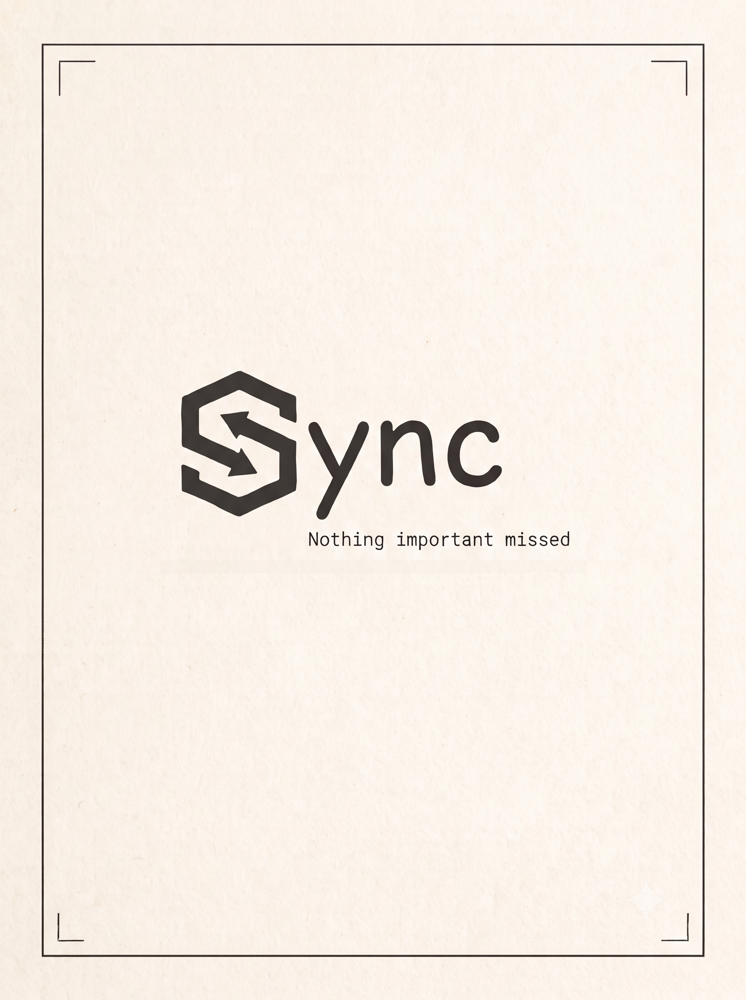
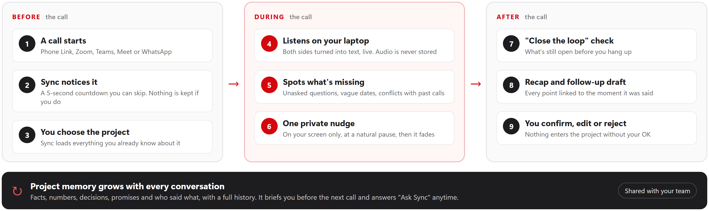
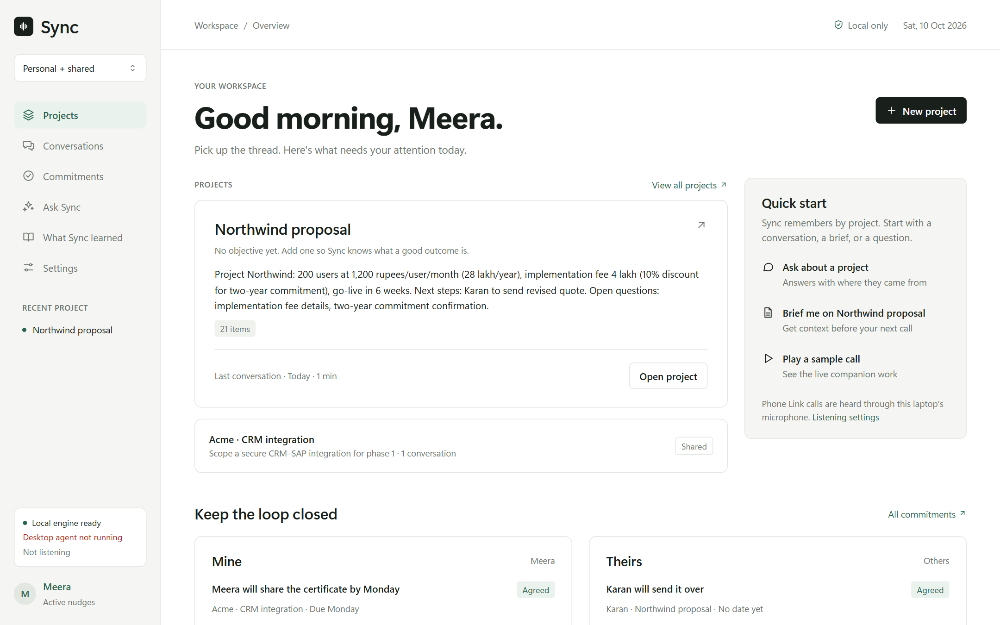
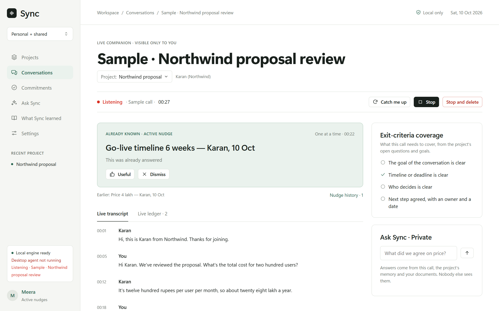
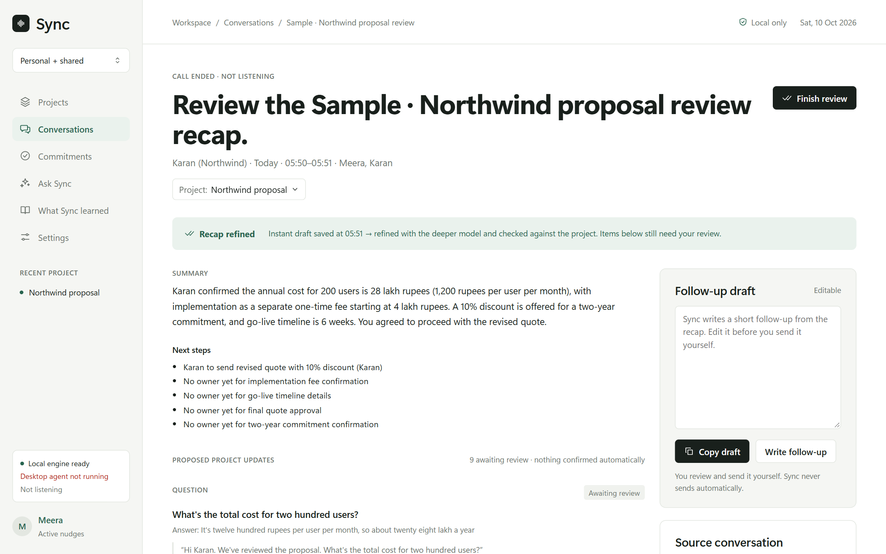
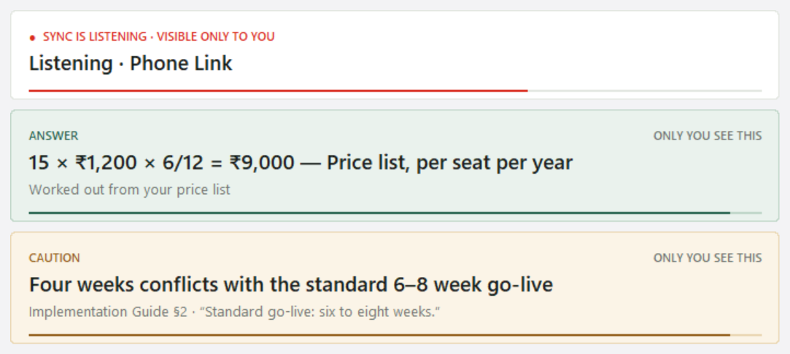
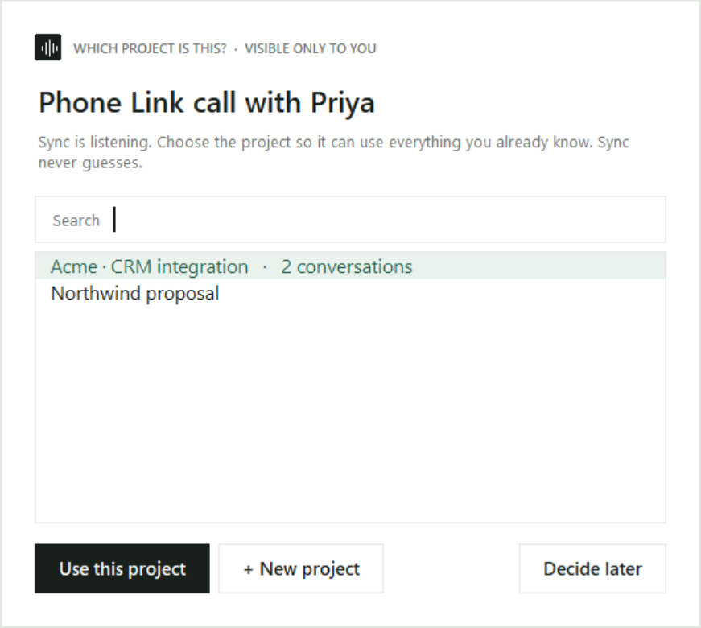
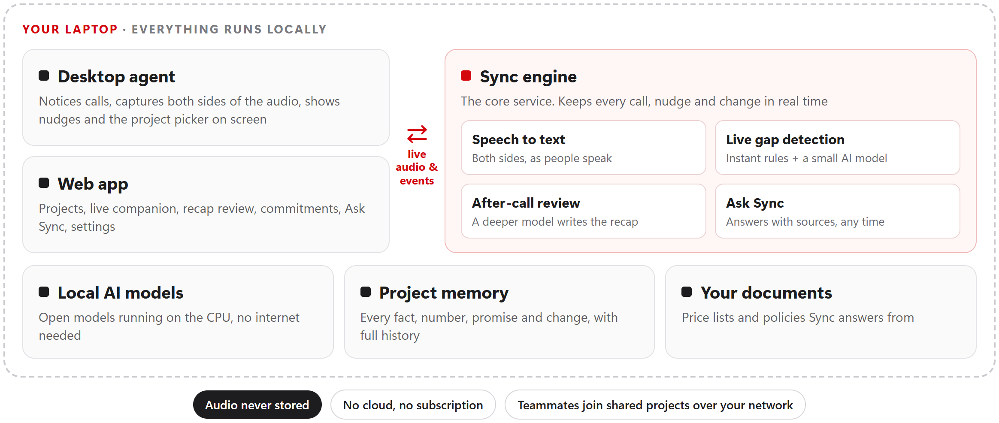

# Sync — your private conversation copilot



## Team Information

- **Team Name**: IISR
- **Track**: General · Problem statement PR 007

## Team Members

| Name | Role | GitHub | LinkedIn |
|------|------|--------|----------|
| Mohammed Aqueel | Backend developer | [@MAAK-001](https://github.com/MAAK-001) | [Profile](https://www.linkedin.com/in/maak001) |
| Adil Hamza | Frontend developer | [@codeadil-hub](https://github.com/codeadil-hub) | [Profile](https://www.linkedin.com/in/adil-hamza01) |

# Project Details

## Overview

Sync is a private copilot for the conversations that matter. It joins your calls on your own laptop, quietly points
out what's being missed while you can still act, and remembers every project, so nothing that was said is ever lost.
Everything runs locally, on free and open-source software.

## Problem Statement

> "People often have to listen, think and respond at the same time, causing important points and decisions to be
> missed."

- **What is the problem?** In a live conversation your attention is full. The question you meant to ask slips away,
  a condition attached to an offer goes unconfirmed, and a task ends up with no owner. The costliest failures are
  omissions, not mistakes.
- **Who is affected?** Anyone whose conversations matter: sales, support, negotiations, client meetings and team
  discussions.
- **Why does it matter?** Omissions surface days later, when the deal stalls or the customer calls back. Work also
  runs over many calls and people, so teams re-ask the same questions and contradict each other.
- **Limits of existing tools:** meeting note-takers summarise *after* the call, when it's too late to ask. Most send
  your audio to the cloud, and none of them hold a project's full history across every conversation.

## Solution

Sync works quietly before, during and after every call, and only you can see it.



1. **Before:** Sync notices a call (Phone Link, Zoom, Teams, Meet, WhatsApp) and gives you 5 seconds to skip it. You
   choose the project, and Sync loads everything it already knows about it.
2. **During:** both sides are turned into text on your laptop. Instant checks and a small local AI model compare
   what's said against the project's memory and your documents. When something is missing or doesn't add up, one
   short, private nudge appears on your screen at a natural pause.
3. **After:** a "close the loop" check lists what's still open. A deeper model writes the recap and a follow-up
   draft, every point linked to the moment it was said. You confirm, edit or reject each update before it's saved.

---

# Demo

### Demo Video

_(add the demo video link)_

### Screenshots

**Workspace:** projects, open commitments and recent calls at a glance.



**Live companion:** the active nudge, the live transcript and the goals still to cover.



**Recap review:** confirm, edit or reject what goes into the project.



**On-screen nudges** (over any app, visible only to you) and the **"Which project is this?"** picker:





---

# Live Project

Sync runs entirely on your own laptop, so there is no hosted version. Follow the setup below, then open
http://127.0.0.1:8765. To try it without a real call, use **Play a sample call**.

---

# Technical Implementation

## Technologies Used

| Category | Technologies |
|----------|--------------|
| **Frontend** | HTML, CSS, JavaScript (no build step); Tk on-screen nudge strip |
| **Backend** | Python, FastAPI, WebSockets |
| **Database** | SQLite with small text embeddings for search |
| **APIs / Services** | None in the cloud: everything runs locally |
| **AI / ML** | Ollama with open models (Granite 4.1 3B live, Qwen3 4B after calls); NVIDIA Parakeet speech recognition |
| **DevOps / Deployment** | Runs on one Windows laptop (CPU only, no GPU) |
| **Other Tools** | pytest, scripted test scenarios and a gap-detection eval |

## System Architecture



- **Desktop agent:** notices calls, captures both sides of the audio, and shows the nudges and the project picker on
  screen.
- **Sync engine:** speech to text, live gap detection, the after-call review and Ask Sync, all on the same laptop.
- **Project memory:** every fact, number, decision and promise, with an append-only history of who changed what and
  when.
- **Web app:** projects, the live companion, recap review, commitments, Ask Sync and settings.

More detail: [motive.md](motive.md) (the why) and [architecture.md](architecture.md) (the design).

## Key Features

- **Auto-listen with an off switch:** joins calls on its own, with a skip countdown, per-app rules and a pause.
- **Live gap detection:** 16 kinds of gaps, including unanswered questions, vague dates, conditions on an offer,
  tasks with no owner, contradictions and over-promises.
- **Answers from your documents:** price lists and policies answered on screen, even quick sums.
- **Project memory with history:** every point is linked to the moment it was said, and every change shows who made
  it.
- **A recap you approve:** nothing enters a project without your OK, and Sync drafts the follow-up for you.
- **Ask Sync and shared projects:** ask about past calls and get answers with sources, or invite teammates to a
  project.
- **Private by default:** audio is never stored, and nobody else on the call is notified.

**Test results:** across 4 scripted scenarios, including a group discussion, Sync caught 13 of 13 planted moments
with no wrong nudges.

---

# Setup Instructions

## Prerequisites

Make sure the following are installed before running the project:

- Windows 10/11 laptop (16 GB RAM recommended; no GPU needed)
- Python 3.11 or newer
- [Ollama](https://ollama.com)

## Installation

### 1. Clone the Repository

```bash
git clone https://github.com/MAAK-001/Sync.git
```

### 2. Install the dependencies

From the `backend` folder:

```bash
python -m venv .venv
```

```bash
.venv/Scripts/python -m pip install -e ".[desktop,dev]"
```

### 3. Download the models

```bash
ollama pull granite4.1:3b
```

```bash
ollama pull qwen3:4b
```

The speech models go into `~/.sync/models/stt`: see "Speech models" in [backend/README.md](backend/README.md).

### 4. Run

Start the backend and the desktop agent, each in its own terminal (from `backend`):

```bash
.venv/Scripts/python -m sync.main
```

```bash
.venv/Scripts/python -m sync.desktop.agent
```

Open http://127.0.0.1:8765 and create your profile. The desktop agent on this laptop signs itself in as you.

Shortcuts: `Ctrl+Alt+S` skips the countdown or stops listening, `Ctrl+Alt+N` hides or shows nudges, and
`Ctrl+Alt+L` starts listening when Sync asks first. Full details, tests and troubleshooting are in
[backend/README.md](backend/README.md).
